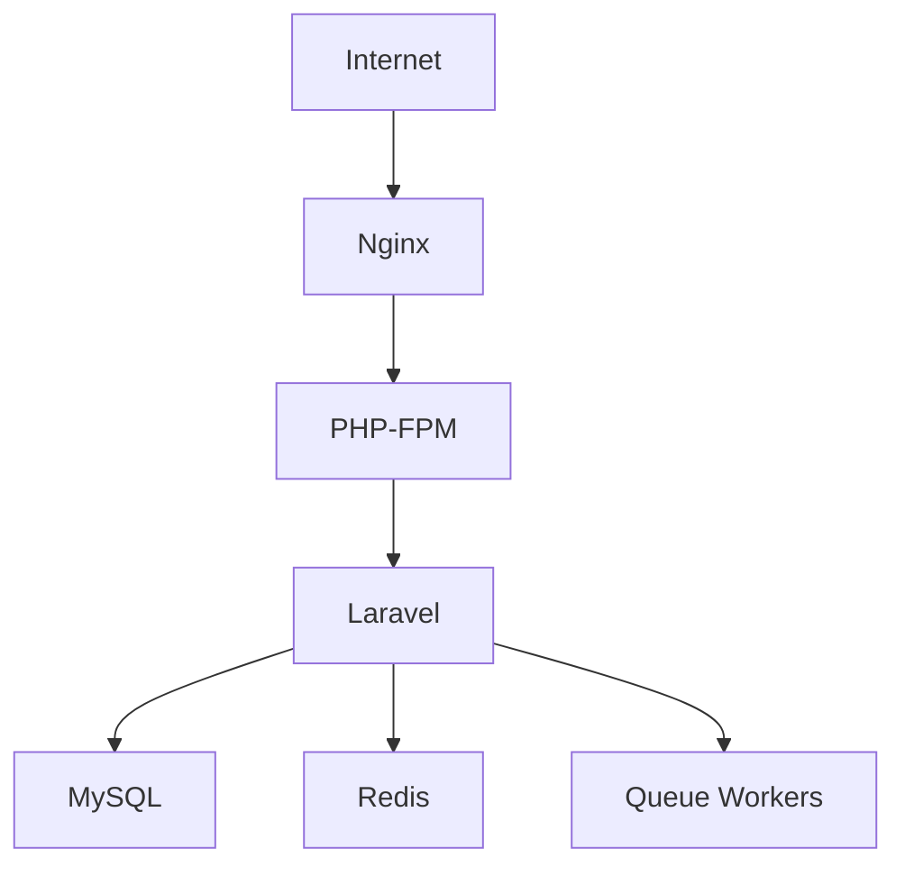

# 🗳️ MWECAU DigiVote (Laravel v2)

[](https://laravel.com)
[](https://php.net)
[](https://www.mysql.com)
[](LICENSE)

> Secure digital voting platform for Mwenge Catholic University student elections.

**No queues. No paper. Just democracy.**

---

## Overview

MWECAU DigiVote is a secure, scalable, and modern electronic voting platform built with Laravel. It enables students to participate in university elections from anywhere while maintaining transparency, security, and voter anonymity.

```text
┌─────────────────────────────────────────┐
│           MWECAU DigiVote               │
│─────────────────────────────────────────│
│     [ Login with Reg Number ]           │
│                                         │
│     Active Elections:                   │
│     ▸ Presidential Election [VOTE →]    │
│     ▸ Residential Leadership [VOTE →]   │
│     ▸ Course Representative [VOTE →]    │
│                                         │
│     Your vote is anonymous & secure     │
└─────────────────────────────────────────┘
```

---

## Features

* Multi-level elections (Presidential, Residential, Course Representative)
* Secure voting with JWT authentication and voter tokens
* Anonymous vote casting
* Self-service password recovery via email
* Real-time election results
* Mobile-friendly responsive design
* Observer dashboard for election monitoring
* Queue-based background processing
* Redis caching support
* <del> API support for future mobile applications </del>
* Voter eligibility validation

---

## Tech Stack

| Component      | Technology                               |
| -------------- | ---------------------------------------- |
| Framework      | Laravel 11 (PHP 8.2+)                    |
| Database       | MySQL 8.0+                               |
| Cache          | Redis                                    |
| Queue          | Redis Queue Workers                      |
| Frontend       | Blade Templates, Tailwind CSS, Alpine.js |
| API            | REST API with Laravel Sanctum            |
| Authentication | Laravel Auth + JWT                       |
| Email          | Laravel Mailables + Queue                |
| File Storage   | Local Storage / Amazon S3                |
| Server         | Nginx + PHP-FPM                          |

---

## Architecture



### Why This Stack?

* Secure authentication and authorization
* Eloquent ORM for database management
* Queue workers for bulk email delivery
* Redis caching for improved performance
* Sanctum token authentication
* Blade templating for fast server-side rendering

---

## Election Scope

| Election Type         | Eligible Voters                                                                              |
| --------------------- | -------------------------------------------------------------------------------------------- |
| Presidential          | All MWECAU students                                                                          |
| Residential           | Students from Kifumbu, Mawela, Kwachange, White House, Moshi Mjini, and On-Campus residences |
| Course Representative | Undergraduate, Postgraduate, and Diploma students                                            |

---

## Application Routes

| Page                   | Route                     |
| ---------------------- | ------------------------- |
| Home                   | `/`                       |
| Login                  | `/login`                  |
| Register               | `/register`               |
| Forgot Password        | `/password-reset`         |
| Dashboard              | `/dashboard`              |
| Elections              | `/elections`              |
| Vote                   | `/elections/{id}/vote`    |
| Results                | `/elections/{id}/results` |
| Commissioner Dashboard | `/commissioner/dashboard` |
| Observer Dashboard     | `/observer/dashboard`     |
| Admin Panel            | `/admin`                  |

---

## Local Development Setup

### Requirements

* PHP 8.2+
* Composer
* MySQL 8.0+
* Redis

### Installation

```bash
# Clone repository
git clone https://github.com/mwecauict-club/mwecau_digivote_laravel.git

cd mwecau_digivote_laravel

# Install dependencies
composer install

# Create environment file
cp .env.example .env

# Generate application key
php artisan key:generate

# Configure database credentials in .env

# Run migrations
php artisan migrate

# Seed database (optional)
php artisan db:seed

# Create storage symlink
php artisan storage:link

# Start development server
php artisan serve
```

Application will be available at:

```text
http://127.0.0.1:8000
```

---

## Production Deployment

### Install Dependencies

```bash
sudo apt update

sudo apt install \
php8.2-fpm \
php8.2-mysql \
php8.2-redis \
composer \
nginx \
mysql-server \
redis-server
```

### Deploy Application

```bash
git clone https://github.com/mwecauict-club/mwecau_digivote_laravel.git /var/www/digivote

cd /var/www/digivote

composer install --optimize-autoloader --no-dev

cp .env.example .env

# Configure production environment variables

php artisan key:generate

php artisan migrate --force

php artisan storage:link

# Set permissions
sudo chown -R www-data:www-data /var/www/digivote

sudo chmod -R 755 storage bootstrap/cache
```

---

## User Roles

| Role          | Description                                   |
| ------------- | --------------------------------------------- |
| Voter         | Participate in eligible elections             |
| Candidate     | Manage campaign profile and contest elections |
| Class Leader  | Manage voter registration data                |
| Commissioner  | Manage elections, users, and analytics        |
| Observer      | Read-only election monitoring                 |
| Administrator | Full system management                        |

---

## Security Features

* Registration Number + Password Authentication
* JWT-based authentication
* One-time voting tokens
* Anonymous ballot storage
* Secure password reset links
* Brute-force protection
* CSRF protection
* Rate limiting
* Security headers (HSTS, CSP, etc.)
* Short-lived access tokens
* Sanctum API authentication

---

## Database Schema

### Core Tables

| Table           | Purpose                  |
| --------------- | ------------------------ |
| users           | System users and voters  |
| elections       | Election information     |
| candidates      | Election candidates      |
| votes           | Anonymous ballot records |
| voter_tokens    | One-time voting tokens   |
| password_resets | Password recovery        |
| login_attempts  | Brute-force monitoring   |

---

## Project Structure

```text
mwecau_digivote_laravel/
├── app/
│   ├── Models/
│   ├── Http/
│   │   ├── Controllers/
│   │   └── Middleware/
│   ├── Mail/
│   └── Jobs/
├── database/
│   ├── migrations/
│   └── seeders/
├── resources/
│   ├── views/
│   └── css/
├── routes/
│   ├── web.php
│   └── api.php
├── config/
├── storage/
├── bootstrap/
├── .env.example
├── nginx.conf
└── docker-compose.yml
```

---

## Contributing

Contributions are welcome.

Please read:

```text
CONTRIBUTING.md
```

before submitting issues or pull requests.

---


## License

This project is licensed under the **GNU General Public License v3.0 (GPL-3.0)**.

See the [LICENSE](LICENSE) file for details.

---

<div align="center">

**© 2026 MWECAU ICT Club**

*One vote at a time.*

</div>
