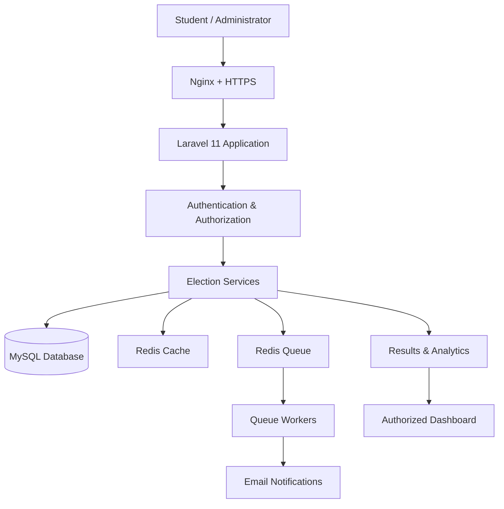

# 🗳️ MWECAU DigiVote — Laravel v2

<div align="center">


<br/>


<br/>

<a href="https://laravel.com"></a>
<a href="https://www.php.net"></a>
<a href="https://www.mysql.com"></a>
<a href="https://redis.io"></a>

<br/>


**No queues. No paper. Just democracy.**

A digital voting platform designed for Mwenge Catholic University student elections, supporting multiple election levels, voter eligibility controls, secure authentication, and election monitoring.

[Features](#-key-features) · [Architecture](#-system-architecture) · [Installation](#-installation) · [Security](#-security) · [Contributing](#-contributing)

</div>

---

## 🌌 Project Vision

<div align="center">


### Transforming Student Elections Through Technology

</div>

MWECAU DigiVote aims to modernize student elections by providing an accessible, transparent, and reliable digital voting experience.

The platform is designed to support:

- 🗳️ Digital ballot casting for eligible voters.
- 🔐 Authentication and voter eligibility verification.
- 🏛️ Multiple election categories and leadership positions.
- 📊 Election monitoring and results dashboards.
- 📱 Mobile-friendly access from different locations.
- ⚙️ Background processing for notifications and administrative tasks.

> **Mission:** Make student elections more accessible, efficient, and accountable through secure digital infrastructure.

## ✨ Key Features

<table>
<tr>
<td width="50%" valign="top">

### 🗳️ Digital Elections

- Presidential elections
- Residential leadership elections
- Course representative elections
- Candidate profiles and nominations
- Election lifecycle management
- Voter eligibility validation

</td>
<td width="50%" valign="top">

### 🔐 Security & Identity

- Registration-number authentication
- Session-based access control
- One-time voting authorization
- Password recovery workflows
- Login throttling and lockout policies
- Role-based permissions

</td>
</tr>
<tr>
<td width="50%" valign="top">

### 📊 Monitoring & Analytics

- Election administration dashboard
- Observer-facing results dashboard
- Election statistics and reports
- Vote auditing with privacy controls
- Periodic results refresh
- Election participation monitoring

</td>
<td width="50%" valign="top">

### ⚡ Performance & Accessibility

- Redis caching
- Asynchronous job processing
- Queued email notifications
- Responsive Blade templates
- REST API support
- Accessible mobile-first interfaces

</td>
</tr>
</table>

## 🎬 Platform at a Glance

<div align="center">

```text
╭────────────────────────────────────────────╮
│             MWECAU DIGIVOTE                │
│         DIGITAL ELECTION PORTAL            │
├────────────────────────────────────────────┤
│                                            │
│  🔐  LOGIN WITH REGISTRATION NUMBER        │
│                                            │
│  ┌──────────────────────────────────────┐  │
│  │ 🗳️  Presidential Election            │  │
│  │     Cast your vote when eligible     │  │
│  ├──────────────────────────────────────┤  │
│  │ 🏠  Residential Leadership            │  │
│  │     Select residential representatives│  │
│  ├──────────────────────────────────────┤  │
│  │ 🎓  Course Representative             │  │
│  │     Choose your course leader        │  │
│  └──────────────────────────────────────┘  │
│                                            │
│  🔒 Protected access  •  📱 Mobile ready   │
│                                            │
╰────────────────────────────────────────────╯
```

*Conceptual interface illustration — not a live application screenshot.*

</div>

## 🧰 Technology Stack

| Component | Technology |
|---|---|
| Backend framework | Laravel 11 |
| Runtime | PHP 8.2+ |
| Database | MySQL 8.0+ |
| Cache | Redis |
| Background jobs | Laravel Queues + Redis |
| Frontend | Blade Templates |
| Styling | Tailwind CSS |
| Interactivity | Alpine.js |
| API authentication | Laravel Sanctum |
| Web authentication | Laravel authentication and sessions |
| Email | Laravel Mail and queued jobs |
| Web server | Nginx + PHP-FPM |
| File storage | Local storage / Amazon S3-compatible storage |

## 🏗️ System Architecture

<div align="center">


<br/>⬇️
<br/>

<br/>⬇️
<br/>

<br/>⬇️
<br/>

<br/>⬇️
<br/>

<br/><br/>


</div>

### Request Lifecycle

1. **Client:** A voter, candidate, commissioner, or observer opens the application.
2. **Web server:** Nginx handles HTTPS and forwards application requests.
3. **Middleware:** Laravel validates the session, permissions, and applicable request limits.
4. **Application:** Controllers execute election workflows and enforce eligibility rules.
5. **Persistence:** Eloquent accesses the MySQL database.
6. **Background processing:** Redis-backed queues process supported asynchronous jobs.
7. **Response:** The application returns the authorized page, API response, or election information.

### Architecture Diagram



*The diagram describes the intended architecture; actual implementation and configuration should be verified against the repository.*

## 🏛️ Election Categories

| Election | Eligible electorate |
|---|---|
| Presidential | All eligible MWECAU students |
| Residential leadership | Eligible students associated with the applicable residence |
| Course representative | Eligible students within the applicable academic programme or course |

Residential categories may include Kifumbu, Mawela, Kwachange, White House, Moshi Mjini, and on-campus residences, subject to official election configuration.

Eligibility should always be determined by the authoritative voter register and election rules.

## 👥 User Roles & Permissions

| Role | Intended permissions |
|---|---|
| **Voter** | Access eligible elections and cast an authorized ballot |
| **Candidate** | Access voter features and manage permitted campaign information |
| **Class Leader** | Perform authorized student-data and registration tasks |
| **Commissioner** | Manage assigned election operations and review authorized analytics |
| **Observer** | Access read-only election monitoring and permitted results |
| **Administrator** | Manage system configuration, accounts, and authorized administration |

**Important:** Enforce permissions on the server, not merely by hiding navigation links or dashboard buttons.

## 🔒 Security & Privacy

<div align="center">


</div>

Security measures to implement and verify include:

- 🔑 **Authentication:** Registration-number and password validation.
- 🛡️ **Authorization:** Server-side role and election-level permission checks.
- 🎟️ **Voting authorization:** Single-use, election-scoped voting credentials.
- 🕵️ **Ballot privacy:** Separation of voter identity from ballot selections wherever the election design permits.
- 🔄 **Password recovery:** Expiring, single-use reset tokens.
- 🚦 **Login protection:** Configurable throttling and temporary lockouts.
- 🧱 **CSRF protection:** Laravel protections for applicable state-changing web requests.
- 🌐 **API controls:** Rate limits and appropriately scoped Sanctum tokens.
- 🔒 **Transport security:** HTTPS, secure cookies, and appropriate security headers.
- 📝 **Auditability:** Restricted administrative audit records without unnecessarily exposing ballot choices.
- 💾 **Recovery:** Scheduled database backups and tested restoration procedures.

### Voting Integrity Principles

1. An eligible voter must not be able to cast more than one ballot in the same election.
2. Ballot submission must be validated and committed safely, using database transactions and appropriate uniqueness constraints.
3. Ballot records must not expose voter identities through ordinary results or administrative views.
4. Election results must be calculated from authoritative, validated ballots.
5. Administrative actions affecting elections must be permission-controlled and auditable.
6. Results publication must follow the configured election rules.

> **Security note:** Authentication, JWTs, one-time tokens, HTTPS, and anonymized tables do not independently prove that an election is secure. Conduct code reviews, authorization tests, concurrency tests, and privacy assessments before using the platform for official elections.

## 🗄️ Database Design

The following tables represent the proposed core data model. Confirm the actual migrations before assuming every table or relationship exists.

| Table | Purpose |
|---|---|
| `users` | User accounts and role assignments |
| `elections` | Election metadata, schedules, and status |
| `candidates` | Candidate information and election associations |
| `votes` | Ballot records |
| `voter_tokens` | Election-scoped voting authorization |
| `password_resets` | Password recovery tokens or framework-supported reset records |
| `login_attempts` | Login throttling and security tracking |

### Suggested Integrity Controls

- Unique constraints for election-specific voter participation.
- Foreign keys for valid election and candidate relationships.
- Transactions for ballot submission.
- Clear rules for election opening, closing, and result publication.
- Strict access controls for ballots, voter registers, and audit logs.
- Separate reporting permissions from ballot-management permissions.

## 🔗 Application Routes

The paths below describe the intended route structure. Actual routes depend on the implementation in `routes/web.php` and `routes/api.php`.

| Page | Expected path |
|---|---|
| Home | `/` |
| Login | `/login` |
| Registration | `/register` |
| Password recovery | `/password-reset` |
| Dashboard | `/dashboard` |
| Active elections | `/elections` |
| Cast a vote | `/elections/{id}/vote` |
| Election results | `/elections/{id}/results` |
| Commissioner dashboard | `/commissioner/dashboard` |
| Observer dashboard | `/observer/dashboard` |
| Administration | `/admin` |

## ⚙️ Installation

### Prerequisites

Ensure the development environment has:

- PHP 8.2 or a compatible version supported by the installed Laravel release.
- Composer.
- MySQL 8.0+.
- Redis.
- Node.js and npm for frontend assets, if required by the project.
- Git.

### 1. Clone the Repository

```bash
git clone https://github.com/mwecauict-club/mwecau_digivote_laravel.git
cd mwecau_digivote_laravel
```

### 2. Install Dependencies

```bash
composer install
```

If frontend assets are managed through Vite and npm:

```bash
npm install
npm run build
```

### 3. Configure Environment Variables

```bash
cp .env.example .env
php artisan key:generate
```

Update the database settings in `.env`:

```dotenv
APP_NAME="MWECAU DigiVote"
APP_ENV=local
APP_DEBUG=true
APP_URL=http://127.0.0.1:8000

DB_CONNECTION=mysql
DB_HOST=127.0.0.1
DB_PORT=3306
DB_DATABASE=digivote
DB_USERNAME=root
DB_PASSWORD=your_local_password

CACHE_STORE=redis
QUEUE_CONNECTION=redis
SESSION_DRIVER=redis
```

Check the configuration keys supported by the project's installed Laravel version and its `.env.example`. Do not commit credentials or production secrets.

### 4. Prepare the Database

Create the `digivote` database in MySQL, then run:

```bash
php artisan migrate
```

If the project includes suitable development seeders:

```bash
php artisan db:seed
```

Only seed test or development environments with non-production data.

### 5. Configure Storage and Start the Application

```bash
php artisan storage:link
php artisan serve
```

In another terminal, start the queue worker when Redis and queue configuration are ready:

```bash
php artisan queue:work redis --tries=3
```

Visit:

```text
http://127.0.0.1:8000
```

## 🚀 Production Deployment

A typical production deployment uses Linux, Nginx, PHP-FPM, MySQL, Redis, HTTPS, and a process supervisor.

### Production Preparation

```bash
composer install --optimize-autoloader --no-dev

php artisan config:cache
php artisan route:cache
php artisan view:cache

php artisan migrate --force
php artisan storage:link
```

Configure production environment variables before running these commands.

### Deployment Checklist

- [ ] Set `APP_ENV=production`.
- [ ] Set `APP_DEBUG=false`.
- [ ] Configure strong database credentials and secret environment variables.
- [ ] Enforce HTTPS and secure session cookies.
- [ ] Configure Nginx and PHP-FPM.
- [ ] Configure Redis cache, sessions, and queues as appropriate.
- [ ] Run queue workers under Supervisor or systemd.
- [ ] Configure email delivery and test notifications.
- [ ] Configure daily backups and test database restoration.
- [ ] Restrict database and Redis network access.
- [ ] Configure log rotation, monitoring, and alerting.
- [ ] Test permissions, election closure, and concurrent ballot submissions.
- [ ] Validate results calculations and ballot privacy.
- [ ] Review the deployment process before applying production migrations.

**Production reminder:** Back up the database before migrations. Never expose `.env`, application keys, database ports, Redis ports, or debug output to the public internet.

## 📂 Project Structure

```text
mwecau_digivote_laravel/
├── app/
│   ├── Models/
│   ├── Http/
│   │   ├── Controllers/
│   │   └── Middleware/
│   ├── Jobs/
│   ├── Mail/
│   └── Policies/
├── bootstrap/
├── config/
├── database/
│   ├── migrations/
│   ├── factories/
│   └── seeders/
├── public/
├── resources/
│   ├── views/
│   ├── css/
│   └── js/
├── routes/
│   ├── web.php
│   └── api.php
├── storage/
├── tests/
├── .env.example
├── composer.json
├── package.json
├── artisan
└── README.md
```

*Directory names may differ from the actual repository. Keep the documentation synchronized with the source code.*

## 🧪 Testing & Quality Assurance

Before a release, verify the critical election workflows.

```bash
# Run automated tests
php artisan test

# Inspect configured routes
php artisan route:list

# Check Laravel configuration
php artisan config:show app
```

Recommended test scenarios:

- [ ] Valid and invalid voter authentication.
- [ ] Voter access to eligible elections only.
- [ ] Rejection of duplicate ballot submissions.
- [ ] Concurrent submissions from the same voter.
- [ ] Candidate and election eligibility validation.
- [ ] Election opening and closing rules.
- [ ] Accurate results aggregation.
- [ ] Unauthorized access to commissioner and admin routes.
- [ ] Password-reset token expiry and reuse prevention.
- [ ] API token expiration, abilities, and rate limits.
- [ ] Ballot privacy and administrative audit access.
- [ ] Database backup and restoration.

## 🛠️ Development Roadmap

The following checklist is a planning aid, not a claim that every feature is already implemented.

- [ ] Review and complete voter registration and authentication.
- [ ] Verify multi-level election creation and management.
- [ ] Complete candidate nomination and campaign profiles.
- [ ] Implement and test single-use voting authorization.
- [ ] Verify the results dashboard and refresh behavior.
- [ ] Complete password recovery by email.
- [ ] Expand commissioner analytics.
- [ ] Complete the observer read-only dashboard.
- [ ] Validate role-specific administrative controls.
- [ ] Optimize background email delivery for large voter groups.
- [ ] Document and test API endpoints.
- [ ] Complete voter eligibility and ballot integrity tests.
- [ ] Strengthen monitoring, backup, and recovery procedures.
- [ ] Conduct an independent security review before official use.

## 🤝 Contributing

Contributions that improve security, usability, accessibility, performance, and maintainability are welcome.

1. Fork the repository.
2. Create a feature branch.
3. Implement the change and add relevant tests.
4. Run the test suite.
5. Submit a pull request describing the change and its impact.

Follow the repository's `CONTRIBUTING.md` if available. Never include real voter information, credentials, or production election data in pull requests or test fixtures.

## 👥 Project Team

| Contributor | Responsibility |
|---|---|
| Cleven | Project Manager & Lead Developer |
| Lajokjohn | Technical Lead |
| Faustine Emmanuel | Feature Developer |
| MWECAU ICT Club | Institutional team |

## 📜 License

This project is licensed under the **GNU General Public License v3.0 (GPL-3.0)**. See the [`LICENSE`](LICENSE) file for the full license terms.

## 🌟 Final Message

<div align="center">


<br/>


**MWECAU DigiVote — One vote at a time.**

© 2026 MWECAU ICT Club

</div>
